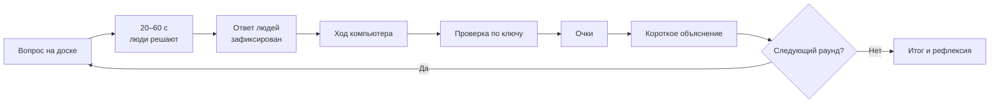
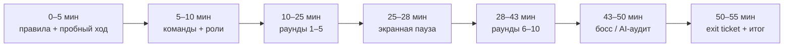
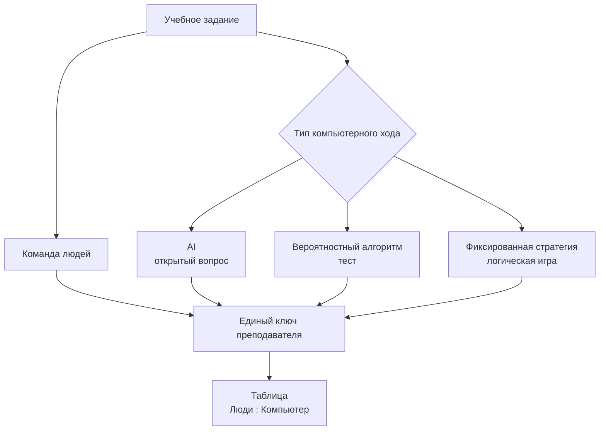

# «Человек против компьютера»: практическая модель интерактивной игры для класса из ~16 учеников

## Краткое резюме

Оптимальная версия **Human vs Computer / «Человек против компьютера»** для класса из примерно 16 учеников и одной интерактивной доски — не обычная викторина, где компьютер показывает вопросы. Компьютер должен быть **отдельной игровой стороной**: давать собственный ответ, иногда ошибаться, набирать очки, менять стратегию или сложность и иметь реальную возможность победить.

Для большинства классов я рекомендую базовую конфигурацию **4 команды × 4 ученика**, но соревнование вести прежде всего как **«весь класс против компьютера»**, а не «четыре команды друг против друга». В каждом раунде одна команда становится активным соперником компьютера. Это сохраняет общий интерес и не превращает урок в наблюдение за четырьмя активными детьми. Для отдельных этапов полезны «активные тройки»: в каждой четверке трое решают задачу, четвертый выполняет роль проверяющего/тренера, после чего роли меняются.

Главная последовательность раунда:



Критически важно сначала **зафиксировать человеческий ответ**, а затем показывать ответ компьютера. Иначе компьютер превращается из соперника в подсказку.

Наиболее практичный вариант одного урока:

| Параметр | Рекомендация |
|---|---|
| Класс | около 16 человек |
| Основная структура | 4 команды по 4 |
| Продолжительность | 45–60 минут |
| Чистое игровое время | 25–35 минут |
| Основная доска счёта | **Люди : Компьютер** |
| Раунд | 1,5–3 минуты |
| Основных раундов | 8–12 |
| Активный человек у доски | один за раз |
| Остальные | решают одновременно на бумаге |
| Базовое начисление | 1 балл за правильный ответ |
| Рассуждение | отдельные раунды по 2 балла |
| Компьютер | AI-бот, скрипт, алгоритм либо комбинация |
| Минимальное оборудование | доска + компьютер учителя + 4 листа/мини-доски + маркеры |
| Интернет | желателен для AI, но не обязателен |

С педагогической точки зрения наиболее сильная часть такого формата — не сама соревновательная оболочка, а многократное **активное извлечение знаний из памяти**, проверка ответа и немедленная обратная связь. Систематический обзор исследований retrieval practice в реальных школах и учебных аудиториях обнаружил устойчивые преимущества такого извлечения знаний для последующего обучения в разных возрастах и предметных областях. citeturn14search2turn14search10

Есть одно важное практическое ограничение для школ в России. Роспотребнадзор указывает, что использование интерактивной доски в течение урока ограничено: для детей до 10 лет — 20 минут, старше 10 лет — 30 минут. Поэтому 45–60-минутный сценарий ниже намеренно чередует работу с экраном и обсуждение/решение на бумаге. Не следует держать доску как постоянно активный игровой экран весь урок. citeturn16search18turn16search24

**Итоговая рекомендация:** начать с формата **«12 раундов: класс против компьютера»**, использовать 4 команды по 4, Wordwall или обычные слайды для контента, локальный счётчик для очков и либо ChatGPT на 3–4 специальных AI-раундах, либо регулируемого алгоритмического соперника для всего матча. Каждые 3–4 раунда менять тип деятельности: тест → логика → перетаскивание → рисунок/визуальная задача. Это лучше использует единственную интерактивную доску, чем попытка заставить всех 16 человек взаимодействовать с ней одновременно.

## Базовая архитектура и принципы честной игры

### Исходные предположения

Поскольку возраст и предмет не заданы, план рассчитан прежде всего на диапазон примерно **10–16 лет**. Для младших учеников нужно уменьшить текст, увеличить время ответа и использовать больше изображений. Для старших можно повышать долю аргументации, задач с неоднозначными данными и проверки ответов AI.

Предполагается:

- один компьютер учителя подключен к сенсорной доске;
- личные телефоны и ноутбуки учеников не требуются;
- интернет может быть доступен, но урок должен переживать его потерю;
- игровые очки используются для мотивации, а итоговая учебная оценка проверяется отдельно;
- содержание урока может быть математическим, языковым, естественно-научным, гуманитарным или межпредметным.

В российских школах интерактивная доска относится к электронным средствам обучения, для которых действуют отдельные требования к организации работы. Роспотребнадзор также подчеркивает требования к размещению и эксплуатации таких средств. citeturn16search0turn16search6

### Когда компьютер действительно является соперником

Чтобы слово «против» имело смысл, компьютер должен удовлетворять пяти условиям:

| Условие | Как реализовать |
|---|---|
| Независимый ход | компьютер формирует ответ без использования человеческого ответа |
| Возможность ошибки | AI отвечает самостоятельно либо алгоритм имеет заданную вероятность успеха |
| Собственный счёт | отдельное поле «Компьютер» |
| Одинаковый критерий проверки | ответы обеих сторон сверяются с одним ключом |
| Возможность выиграть | результат матча не должен быть заранее предопределен |

Самая важная процедура — **commit before reveal**:

**вопрос → обсуждение людей → фиксация ответа → ответ компьютера → проверка**.

Если используется генеративный AI, ключ правильного ответа лучше не помещать в AI-промпт. Ключ остается у преподавателя. Тогда AI действительно решает задачу, а не воспроизводит заранее данный ответ.

### Рекомендуемая организация шестнадцати учеников

**Основной режим — 4 × 4.**

Внутри каждой четверки четыре сменяемые роли:

1. решающий;
2. скептик, который ищет ошибку;
3. секретарь;
4. представитель у доски.

После каждого раунда роли сдвигаются. Тогда ученик, который хорошо и быстро говорит, не становится постоянным представителем всей команды.

**Режим троек — 4 активных трио + 4 тренера.** Каждая команда из четырех на один раунд делится на трио решающих и одного тренера-наблюдателя. В следующем раунде тренером становится другой человек. Это значительно удобнее, чем создавать пять троек и одного постоянно «лишнего» ученика.

**Индивидуальный режим — случайный вызов.** Имя выбирается только после того, как все получили время подумать. Для полного равенства лучше использовать не независимую случайную выборку с повторениями, а перемешанный список без повторения. Wheel of Names позволяет выбирать имена случайным образом и использовать колесо в классе именно для выбора отвечающего; сервис также поддерживает веса, если они действительно нужны. citeturn11search2

Практический принцип:

> Случайным должен быть **выбор отвечающего**, но не возможность подумать.

Все 16 сначала решают вопрос. После этого определяется тот, кто озвучивает ответ.

### Темп и счёт

Обычный раунд занимает около двух минут:

| Фаза | Время |
|---|---:|
| Показ задания | 10–15 с |
| Индивидуальное обдумывание | 10–20 с |
| Обсуждение команды | 20–40 с |
| Фиксация ответа | 5 с |
| Ход компьютера | 5–15 с |
| Проверка и объяснение | 20–40 с |

Для знаний на воспроизведение подходит **1 балл за правильность**. Для задач, где важен ход мысли, удобнее:

- правильный результат — 1;
- корректное обоснование — еще 1.

Тот же критерий применяется к компьютеру, если он получает право на объяснение.

Не стоит выдавать генеративному AI бонус просто за длинное объяснение. Компьютер легко производит текст. Бонус должен даваться только за заранее сформулированный содержательный критерий: например, «названа причина и приведено доказательство».

## Форматы игры

Ниже пять полноценных вариантов. Их можно использовать отдельно или соединить в один урок.

| Формат | Игроки | Время | Компьютер | Подготовка | Сильные стороны | Ограничения |
|---|---:|---:|---|---|---|---|
| **Класс против AI** | 4 команды × 4 | 25–35 мин | AI отвечает на те же вопросы | средняя | универсален, понятный счет | AI иногда дает спорные ответы |
| **Рейд на босса** | весь класс | 20–30 мин | «босс» с HP и контратаками | низкая–средняя | сильное общее чувство цели | счет чуть сложнее |
| **Трио-эстафета** | 4 трио + 4 сменных тренера | 20–25 мин | таймер + алгоритм | средняя | высокая активность внутри групп | нужна четкая смена ролей |
| **Случайная дуэль** | по одному ученику за ход | 15–25 мин | AI или скрипт | низкая | индивидуальная ответственность | нельзя вызывать до времени на размышление |
| **Поймай ошибку AI** | 4 команды × 4 | 15–30 мин | AI дает решение/объяснение | средняя | проверяет аргументацию и AI-грамотность | учителю нужен надежный ключ |

### «Класс против AI»

Это наиболее универсальный вариант.

На доске постоянно показывается:

**ЛЮДИ  5 : 4  КОМПЬЮТЕР**

Раунды распределяются A → B → C → D → A → B… Активная команда дает официальный ответ класса. Остальные команды решают тот же вопрос, но не выкрикивают. При ошибке активной команды учитель иногда разрешает «перехват» другой команде.

**Материалы:** доска, 10–12 вопросов, таблица счета, четыре листа для ответов.

**Счет:** правильный ответ — 1:0, если правильны обе стороны — 1:1, если ошиблись обе — 0:0. В трех заранее обозначенных раундах аргументации можно получить второй балл.

**Победа:** больше очков после последнего раунда.

Хорошая структура из 12 раундов:

- 4 быстрых знания;
- 3 логических;
- 2 визуальных/drag-and-drop;
- 2 задания на объяснение;
- 1 финальный сложный вопрос.

### «Рейд на компьютерного босса»

На доске изображается условный компьютер с **10 HP**. У людей есть **4 батареи/жизни**.

Каждый раунд обе стороны решают одну задачу.

| Люди | Компьютер | Последствие |
|---|---|---|
| верно | неверно | босс теряет 2 HP |
| верно | верно | босс теряет 1 HP |
| неверно | верно | люди теряют 1 жизнь |
| неверно | неверно | ничего |

**Победа людей:** HP компьютера достигает нуля.

**Победа компьютера:** заканчиваются четыре человеческие жизни либо истекает число раундов.

Такой формат удобен, если не хочется сравнивать команды между собой. Каждая команда «атакует» одного общего противника.

Важный баланс: компьютер не должен иметь 90–100% точность на обычных школьных вопросах. Для алгоритмического соперника разумно задать примерно 55–65% на первом пробном раунде и затем откалибровать его так, чтобы победа оставалась реально возможной для обеих сторон. Это не статистическая норма, а предлагаемая игровая настройка.

### «Трио-эстафета»

Класс остается разбитым на четыре четверки. В каждой:

**3 ученика решают + 1 тренер проверяет процесс.**

Через один раунд роли меняются.

Используются короткие испытания:

- найти закономерность;
- распределить карточки;
- собрать порядок;
- дорисовать схему;
- решить логическую задачу;
- исправить ошибочный ответ.

На решение — 60–90 секунд.

Одновременно компьютер выполняет собственную версию задачи. Для закрытого вопроса это может быть регулируемый алгоритм. Для открытого — AI.

Счет команды не обязательно выводить публично. Можно давать каждому трио одну «звезду вклада» за успешный ход, а главный результат по-прежнему вести как **Люди : Компьютер**.

**Победа:** восемь испытаний; сторона, выигравшая больше испытаний, побеждает матч.

### «Случайная дуэль»

Этот вариант особенно полезен, когда преподавателю важно проверить индивидуальную готовность.

Порядок:

1. задание появляется для всех;
2. все думают 20–30 секунд;
3. все команды записывают ответ;
4. генератор выбирает ученика;
5. выбранный ученик отвечает;
6. компьютер дает свой ответ;
7. проверяется результат.

Компьютер и ученик получают по одному баллу за правильность.

Не следует сначала выбирать ученика, а потом показывать вопрос: остальные 15 человек быстро понимают, что их ответ уже не нужен.

Для восьми раундов можно заранее случайно сформировать восемь пар. Первый ученик пары отвечает, второй становится проверяющим. Таким способом все 16 получают формальную роль.

### «Поймай ошибку AI»

В этом варианте AI не столько отвечает, сколько **защищает свое решение**.

Пример:

> Компьютер: «Все простые числа нечетные. Поэтому 2 не является простым».

Команды получают 45 секунд:

- принять решение;
- найти конкретную ошибку;
- исправить ее;
- при необходимости привести контрпример.

Счет:

- ошибка AI действительно обнаружена — люди +1;
- корректное исправление — еще +1;
- обвинение AI в ошибке, когда ответ был правильным, — компьютер +1;
- AI-ответ выдерживает проверку — компьютер +1.

Это хороший формат для обучения проверке машинных ответов. UNESCO в своей рамке компетенций по AI для учащихся рассматривает ответственное, критическое и осмысленное взаимодействие с AI как отдельную область компетентности; поэтому режим «проверить компьютер», а не «поверить компьютеру», особенно уместен. citeturn14search20

## Как сделать компьютер настоящим соперником

Один механизм необязательно использовать весь урок. На практике эффективнее чередовать три режима: **AI, регулируемый алгоритм и фиксированную компьютерную стратегию**.

### AI-викторина

Преподаватель открывает AI в отдельной вкладке. Люди сначала фиксируют ответ. Затем тот же вопрос передается AI.

Преимущество — компьютер действительно решает задачу.

Недостаток — возможны спорные формулировки, нестабильность ответа и различное время генерации. Поэтому **скорость генерации AI лучше не учитывать в счете**. Время важно для людей, а AI оценивается по правильности.

Стартовый промпт:

```text
Ты — сторона «Компьютер» в учебной игре «Люди против компьютера».

Правила:
1. Отвечай только после сообщения, начинающегося с GO:.
2. Не проси подсказок.
3. Не меняй ответ после того, как он дан.
4. На GO отвечай только в формате:

ОТВЕТ: <краткий окончательный ответ>
УВЕРЕННОСТЬ: <0–100>%

5. Не добавляй объяснение.
6. После команды EXPLAIN дай объяснение максимум в двух предложениях.
7. Если не уверен, всё равно выбери один ответ.
8. Не используй ответ учеников: он тебе не сообщается.
9. Не используй веб-поиск.

Жди первого GO:.
```

Для работы с учащимися разумно использовать AI только с аккаунта преподавателя и не передавать сервису имена, персональные сведения или ученические профили. В ChatGPT преподаватель может отключить использование новых разговоров для улучшения моделей через Data Controls; Temporary Chat не помещается в обычную историю и не используется для улучшения моделей, хотя копия может временно сохраняться в целях безопасности. Для Business, Enterprise, Edu и API действуют другие настройки использования данных. citeturn13search0turn13search1turn13search3

### Регулируемый компьютер

Для стабильной игры генеративный AI даже не обязателен.

Для вопроса с четырьмя вариантами компьютер получает вероятность правильного ответа:

- уровень 1: 55%;
- уровень 2: 70%;
- уровень 3: 85%.

Если «бросок» успешен, компьютер выбирает правильный ответ. Иначе случайно выбирает один из неправильных.

Это искусственный оппонент, но его преимущество в том, что преподаватель точно контролирует баланс.

Пример функции:

```javascript
function computerAnswer(options, correctIndex, accuracy = 0.70) {
  if (Math.random() < accuracy) {
    return options[correctIndex];
  }

  const wrong = options.filter((_, i) => i !== correctIndex);
  return wrong[Math.floor(Math.random() * wrong.length)];
}
```

Такой компьютер полезнее полностью случайного ответа. Он достаточно силен, чтобы представлять угрозу, но не выигрывает автоматически.

### Адаптивная сложность

Адаптацию лучше делать **прозрачной**.

Например:

- если люди ведут на 3+ очка, точность компьютера повышается на 10 процентных пунктов;
- если компьютер ведет на 3+, точность снижается на 10 пунктов;
- границы — от 45% до 90%.

Не стоит тайно давать слабым учащимся «детские вопросы». Это быстро воспринимается как маркировка уровня ученика. Лучше изменять характеристики **компьютерной стороны** либо давать одинаковые публичные бонусы отстающей стороне.

В качестве «гандикапа» подходят:

| Гандикап | Эффект |
|---|---|
| +15 секунд людям | помогает более медленным группам |
| один бесплатный намек | снижает барьер без выдачи ответа |
| «50:50» | убирает два варианта |
| право на один повторный ответ | полезно младшим классам |
| компьютер начинает с −1 | простейшая коррекция слишком сильного AI |
| точность алгоритма −10 п.п. | незаметно для содержания задания |
| компьютер обязан дать объяснение | увеличивает шанс найти ошибку |

### Алгоритмический соперник

В отдельных заданиях компьютер может использовать настоящую стратегию, а не вероятность.

Например, в игре «21»:

- на столе виртуально 21 фишка;
- за ход можно забрать 1–3;
- люди и компьютер ходят по очереди;
- компьютер пытается заканчивать свой ход на количестве, кратном четырем.

Здесь ученики постепенно могут обнаружить алгоритм. После матча вопрос меняется с «кто победил?» на «какую стратегию использовал компьютер?».

Scratch подходит для создания подобных прозрачных игровых противников: официальный проект Scratch предназначен для создания интерактивных историй, игр и анимаций и доступен бесплатно. citeturn10search2

### Автоматическая таблица результатов

Автоматизировать нужно только то, что экономит время:

- счет Люди : Компьютер;
- текущий номер раунда;
- случайный выбор ученика;
- уровень AI;
- серия побед;
- финального победителя.

Сложная электронная турнирная таблица для 16 учеников обычно создает больше переключений, чем пользы.

Главный экран должен оставаться максимально простым:

```text
          ЛЮДИ       КОМПЬЮТЕР
            6     :      5

Раунд 9 / 12
Активная команда: C
Сложность компьютера: 70%
Осталось: 00:34
```

## Банк из двадцати готовых заданий

Вопросы ниже намеренно смешивают предметы и типы деятельности. Их можно непосредственно перенести в слайды, Wordwall или Genially.

| № | Предмет / тип | Сложность | Готовое задание | Ответ / критерий |
|---:|---|---|---|---|
| 1 | Математика, быстрый тест | низкая | **Чему равны 15% от 240?** A 24; B 30; C 36; D 40 | **36** |
| 2 | Алгебра | средняя | **Решите:** \(3(x-2)=18\) | **x = 8** |
| 3 | Математика, логика | средняя | **Какое наименьшее положительное число делится и на 4, и на 6, но не делится на 8?** | **12** |
| 4 | Закономерность | низкая | **3, 6, 12, 24, ?** | **48** |
| 5 | Закономерность | средняя | **2, 5, 10, 17, 26, ?** Объясните правило. | **37**; прибавляются 3, 5, 7, 9, 11 |
| 6 | Логическая задача | высокая | **Есть 3 выключателя вне закрытой комнаты и одна лампа внутри. В комнату можно войти один раз. Как определить выключатель лампы?** | Включить A, подождать, выключить; включить B; войти. Горит=B, теплая=A, холодная=C |
| 7 | Вероятность | средняя | **Подбрасывают две честные монеты. Какова вероятность получить ровно один орел?** | **1/2** |
| 8 | Физика | средняя | **Если скорость тела увеличилась в 2 раза, во сколько раз выросла его кинетическая энергия при неизменной массе?** | **В 4 раза** |
| 9 | Физика, мультимедиа | средняя | Покажите 5-секундный беззвучный клип мяча, брошенного вверх. Поставьте на паузу в верхней точке. **Куда направлено ускорение?** | **Вниз** |
| 10 | Химия, drag-and-drop | низкая | Перетащите **pH 2 / pH 7 / pH 11** в зоны «кислота / нейтральная / щёлочь» | 2 → кислота; 7 → нейтр.; 11 → щёлочь |
| 11 | Биология | низкая | **Какая органелла эукариотической клетки в школьной модели главным образом связана с синтезом ATP при клеточном дыхании?** | **Митохондрия** |
| 12 | Биология, drag-and-drop | средняя | Расставьте: **желудок / рот / толстая кишка / пищевод / тонкая кишка** | рот → пищевод → желудок → тонкая → толстая кишка |
| 13 | География | низкая | **Столица Канады:** Торонто / Ванкувер / Оттава / Монреаль | **Оттава** |
| 14 | География, пространственная | средняя | Расположите с севера на юг: **Каир, Москва, Рим** | **Москва → Рим → Каир** |
| 15 | История, drag-and-drop | средняя | Расположите по времени: **полёт «Спутника-1» / путешествие Колумба 1492 / Французская революция / европейское книгопечатание Гутенберга** | Гутенберг → Колумб → Французская революция → «Спутник-1» |
| 16 | Русский язык | средняя | Выберите правильное: **«в течение часа» или «в течении часа»**, если имеется в виду время | **в течение часа** |
| 17 | Английский язык | средняя | **If I ___ more time, I would learn another language.** A have; B had; C will have; D would have | **had** |
| 18 | Информатика | средняя | **Переведите \(10110_2\) в десятичную систему.** | **22** |
| 19 | Математика, рисунок | средняя | На координатной плоскости **нарисуйте \(y=2x-1\)**. | Линия должна, например, проходить через **(0,−1)** и **(1,1)** |
| 20 | AI/логика, аудит ответа | средняя | Компьютер утверждает: **«Все простые числа нечетные, потому что каждое четное число делится на 2». Найдите ошибку.** | **2 — четное и простое число; утверждение “все” неверно** |

Для №9 не нужен специальный учебный фильм. Достаточно собственной короткой анимации или записи движения мяча. Это уменьшает зависимость от сети.

Для задания №19 ученик работает непосредственно на интерактивной доске. Остальные сначала рисуют график на бумаге. Таким образом доска служит не устройством для одного человека, а финальной общей зоной проверки.

Еще несколько способов быстро превращать обычный вопрос в более сильное задание:

| Вместо… | Сделать… |
|---|---|
| «Назовите правильный ответ» | «Ответьте и укажите, какой вариант компьютер выберет ошибочно» |
| «Решите пример» | «Найдите ошибку в компьютерном решении» |
| «Соотнесите понятия» | drag-and-drop на доске |
| «Назовите порядок» | перемешанные карточки |
| «Что изображено?» | скрывать изображение частями |
| «Верно/неверно» | «Верно/неверно + одно доказательство» |
| один ответ | «Ответ + уровень уверенности 0–100%» |

Последний вариант особенно интересен при игре против AI: после раскрытия ответа можно сравнить не только правильность, но и **калибровку уверенности**.

## Урок на одной интерактивной доске: темп, управление, оценивание и доступность

### Расстановка и минимальные материалы

Не нужно 16 устройств.

Достаточно:

- интерактивной доски;
- компьютера преподавателя;
- четырех листов A4 или четырех небольших маркерных досок;
- четырех маркеров;
- при желании — четырех карточек A/B/C/D.

Доска используется для пяти функций:

**задание → компьютерный ход → манипуляция → проверка → общий счет**.

Командное мышление происходит в основном **не у доски**. Это принципиально важно при единственном сенсорном экране.

Рекомендуемая схема класса:

```text
                 ИНТЕРАКТИВНАЯ ДОСКА
       ┌─────────────────────────────────┐
       │  вопрос | таймер | счет | AI   │
       └─────────────────────────────────┘

          [A]                  [B]
       4 ученика            4 ученика


          [C]                  [D]
       4 ученика            4 ученика

                  Учитель
```

Не следует устраивать физические «гонки к доске». Быстрота бега никак не связана с учебной целью, усложняет доступность и создает ненужное преимущество учащимся с большей мобильностью.

### Сценарий на 55 минут



| Время | Что происходит | Задача преподавателя |
|---|---|---|
| 0–5 | показать механику на одном легком вопросе | убедиться, что правило «сначала люди, потом компьютер» понятно |
| 5–10 | 4 команды, распределение ролей | назвать очередность A–B–C–D |
| 10–25 | 5 основных раундов | держать темп около 2–3 минут |
| 25–28 | работа без доски | короткая бумажная задача, смена ролей |
| 28–43 | еще 5 раундов | включить более сложные типы задач |
| 43–50 | финальный «босс» или «поймай AI» | перейти от скорости к аргументации |
| 50–55 | три индивидуальных exit-вопроса | отделить реальное обучение от игрового счета |

Если требуется **45 минут**, сокращаются не обсуждения, а количество раундов:

**4 мин правила → 4 мин организация → 24 мин игра → 7 мин финал → 6 мин индивидуальная проверка.**

Если урок проводится в российской школе, такой разрыв на бумажную работу помогает соблюдать ограничения по использованию интерактивной доски. Для учащихся старше 10 лет Роспотребнадзор указывает до 30 минут использования интерактивной доски в течение урока, а для детей до 10 лет — до 20 минут. citeturn16search18turn16search24

### Управление шумом и ожиданием

Три правила стоит вывести на первом экране:

**«Обсуждаем внутри команды. Не выкрикиваем. Ответ фиксируем до хода компьютера.»**

За выкрикивание не стоит отнимать учебные баллы: это смешивает знание предмета и дисциплину. Лучше использовать отдельный игровой ресурс, например команда теряет один «жетон подсказки».

Команда, которая закончила первой, обязана не кричать «готово», а выполнить вторую задачу:

> «Проверьте ответ и придумайте одну причину, почему другой вариант мог показаться правильным».

Это превращает лишние 20 секунд в проверку собственного рассуждения.

### Честность и вовлечение

**Ротация.** Один ученик не может дважды подряд быть представителем.

**Выбор без повторений.** Если используется случайный вызов, имя временно исключается из пула до завершения цикла.

**Перехват.** Если активная команда ошиблась, другая команда получает только половинный/бонусный балл. Иначе возникает стимул не помогать классу.

**Намек как ресурс.** Каждая команда получает один жетон Hint. Намек сужает задачу, но не дает ответ.

**AI не получает человеческую подсказку.** Ответ класса не читается AI до завершения компьютерного хода.

**Одинаковый ключ.** Решение преподавателя, а не сам AI, является арбитром.

**Спорный вопрос аннулируется.** Ни одна сторона не получает балла.

**Ничья.** Лучший tie-break — не случайность, а короткая задача с численным ответом: выигрывает сторона, чей ответ ближе. Например:

> «Не вычисляя на калькуляторе, оцените \(49 \times 51\).»

Точный ответ — 2499.

### Учебные цели и оценивание

Игровые очки не следует автоматически переводить в школьную отметку. Результат зависит от команды, случайного выбора отвечающего, режима AI и выбранного гандикапа.

Лучше разделить **game score** и **learning evidence**.

| Учебная цель | Доказательство во время игры | Индивидуальная проверка |
|---|---|---|
| воспроизвести факт/правило | доля правильных ответов | 1 аналогичный вопрос |
| применить правило | решение новой задачи | новый пример |
| распознать закономерность | объяснение паттерна | новый паттерн |
| аргументировать | бонусный reasoning-раунд | одно письменное обоснование |
| выявить ошибку | AI-аудит | исправить новое ошибочное решение |
| сотрудничать | выполнение сменяемых ролей | самооценка/наблюдение преподавателя |
| AI-грамотность | проверка машинного ответа | «как проверить этот ответ?» |

Retrieval practice особенно хорошо соответствует первым двум целям: вместо повторного чтения учащийся вынужден восстановить ответ из памяти, после чего получает обратную связь. Обзор прикладных школьных исследований показывает пользу такого подхода в разных предметах и возрастных группах. citeturn14search2

Хороший exit ticket из трех пунктов:

1. один вопрос, очень похожий на игровой;
2. один вопрос с переносом в новую ситуацию;
3. «Какой ответ компьютера сегодня следовало проверить особенно тщательно и почему?»

Тогда преподаватель получает индивидуальные данные от всех 16 человек, даже если формально на доске каждый выступал только один-два раза.

### Доступность и дифференциация

Логика Universal Design for Learning состоит в том, чтобы заранее проектировать среду, пригодную для учащихся с различными возможностями и исходными условиями, а не добавлять «исключения» после возникновения проблемы. CAST описывает UDL именно как рамку для создания более инклюзивного обучения. citeturn2search23

Практически это означает:

| Потребность | Изменение игры |
|---|---|
| трудно читать с доски | тот же вопрос на крупном листе команды |
| зрительные особенности | высокий контраст, крупные элементы, минимум текста |
| трудности чтения | учитель зачитывает вопрос вслух |
| нарушения слуха | весь аудиоконтент имеет текстовую альтернативу |
| ограниченная моторика | ответ можно диктовать представителю; не требуется быстро подходить к доске |
| медленная обработка информации | +15–30 секунд либо предварительное чтение |
| языковая поддержка | краткий словарь ключевых терминов |
| сильные учащиеся | получают задачу «объясни», а не просто более длинный пример |
| тревожность | один Pass-token или ответ через представителя |
| трудности удержания внимания | роли и задачи меняются каждые 2–4 минуты |

Дифференцировать полезнее **форму поддержки**, чем объявлять вслух, кто получает «легкий уровень».

## Инструменты и пошаговая реализация

### Какие инструменты подходят при одной доске

| Инструмент | Роль | Одна доска без ученических устройств | Что особенно полезно | Ограничение |
|---|---|---|---|---|
| **Wordwall** | вопросы, сортировка, drag-and-drop, колесо | **да** | быстрый контент | компьютерного соперника лучше добавить отдельно |
| **Genially** | игровое поле, квест, интерактивная презентация | **да** | визуально сложные сценарии | подготовка дольше |
| **Scratch** | собственный компьютерный соперник | **да** | счет, алгоритмы, случайность | нужно собрать проект |
| **Wheel of Names** | случайный выбор | **да** | имена, порядок, веса | это не система оценивания |
| **ChatGPT** | настоящий AI-соперник | **да** | открытые ответы и объяснения | ответы нужно проверять |
| **Kahoot** | готовые тесты | частично | знакомая quiz-механика | штатный Team Mode предполагает устройство команды |
| **Web Whiteboard / Miro** | рисунки и схемы | **да** | свободное рисование | лишний сервис, если доска уже имеет ПО |

Wordwall особенно удобен для этого сценария: официальный сервис заявляет более 30 типов активностей, включая Quiz, Match up, Flashcards, Spin the wheel и Group sort, а шаблон существующего задания можно быстро заменить другим. Это хорошо соответствует одной общей интерактивной поверхности. citeturn10search0

Genially ориентирован на создание интерактивных презентаций, викторин, игр и другого интерактивного контента, поэтому он удобнее Wordwall, если нужен полноценный «экран босса», карта уровней или разветвленный сюжет. citeturn1search3

Scratch лучше выбрать, если преподавателю нужен собственный алгоритмический соперник без генеративного AI. Он предназначен именно для создания интерактивных игр и анимаций. citeturn10search2

Wheel of Names подходит для публичного случайного вызова ученика: сервис прямо приводит выбор отвечающего ученика как один из вариантов использования и позволяет работать с весами. Для честного обычного урока веса лучше оставить одинаковыми. citeturn11search2

Kahoot здесь не является первым выбором. Его официальный Team Mode построен вокруг маленьких команд с **одним устройством на команду**. Поэтому при строгом условии «только одна интерактивная доска» Kahoot удобнее использовать как источник/экран вопросов, а не как ядро игры. citeturn9search12

### Самая простая no-code конфигурация

**Нужно открыть четыре вкладки:**

```text
[Вопросы] [Компьютер-AI] [Случайный выбор] [Счет]
 Wordwall    ChatGPT       Wheel           слайд
```

Шаги перед уроком:

**Сначала** подготовить 10–12 заданий и отдельный бумажный ключ.

**Затем** перенести задания в Wordwall, Genially либо обычные слайды.

**Далее** вставить 16 имен в Wheel of Names.

**После этого** открыть AI и вставить игровой промпт.

**Наконец** сделать тестовый раунд и проверить, что переключение между вкладками занимает несколько секунд.

Во время урока:

```text
Показ вопроса
      ↓
Команды решают
      ↓
Ответ людей фиксируется
      ↓
Переключение на AI
      ↓
AI отвечает
      ↓
Возврат к вопросу
      ↓
Ключ + счет
```

На большинстве раундов AI даже не нужно выводить на экран. Учитель может вызвать его только после фиксации человеческого ответа.

### Более надежная конфигурация без интернета

Можно полностью отказаться от AI:

**слайды/Wordwall offline-эквивалент + локальная HTML-страница соперника**.

Ниже небольшой автономный счетчик. Он работает прямо в браузере. Интернет и сервер не требуются.

Сохраните текст как `human-vs-computer.html` и откройте файл двойным щелчком:

```html
<!doctype html>
<html lang="ru">
<head>
<meta charset="utf-8">
<title>Люди против компьютера</title>
<style>
  body {
    font-family: system-ui, sans-serif;
    max-width: 900px;
    margin: 30px auto;
    text-align: center;
    font-size: 24px;
  }

  #score {
    font-size: 64px;
    margin: 25px;
  }

  button, select, input {
    font-size: 22px;
    padding: 10px 16px;
    margin: 6px;
  }

  #result {
    min-height: 60px;
    margin: 20px;
  }
</style>
</head>

<body>

<h1>Люди против компьютера</h1>

<div id="score">
  <span id="human">0</span>
  :
  <span id="computer">0</span>
</div>

<label>
  Сила компьютера:
  <select id="level">
    <option value="0.55">Легко — 55%</option>
    <option value="0.70" selected>Средне — 70%</option>
    <option value="0.85">Сложно — 85%</option>
  </select>
</label>

<br>

<label>
  <input id="adaptive" type="checkbox">
  Адаптивный режим
</label>

<div>
  <button onclick="humanPoint()">Люди +1</button>
  <button onclick="computerTurn()">Ход компьютера</button>
  <button onclick="resetGame()">Новая игра</button>
</div>

<div id="result">Компьютер ждёт хода.</div>

<hr>

<p>Имена через запятую:</p>

<input
  id="names"
  style="width:80%"
  value="Анна, Борис, Вера, Глеб, Даша, Егор, Жанна, Иван,
         Катя, Лев, Мария, Никита, Ольга, Павел, Рита, Сергей"
>

<br>

<button onclick="pickStudent()">Случайный ученик</button>

<div id="student"></div>

<script>
let human = 0;
let computer = 0;

function updateScore() {
  document.getElementById("human").textContent = human;
  document.getElementById("computer").textContent = computer;
}

function humanPoint() {
  human++;
  updateScore();
}

function computerAccuracy() {
  let p = Number(document.getElementById("level").value);

  if (document.getElementById("adaptive").checked) {
    // Если люди ведут, компьютер немного усиливается.
    // Если компьютер ведет, он немного ослабевает.
    p += (human - computer) * 0.03;

    // Ограничиваем диапазон.
    p = Math.max(0.45, Math.min(0.90, p));
  }

  return p;
}

function computerTurn() {
  const p = computerAccuracy();
  const correct = Math.random() < p;

  if (correct) {
    computer++;
    document.getElementById("result").textContent =
      `Компьютер: ВЕРНО (текущая сила ${Math.round(p * 100)}%)`;
  } else {
    document.getElementById("result").textContent =
      `Компьютер: ОШИБКА (текущая сила ${Math.round(p * 100)}%)`;
  }

  updateScore();
}

function pickStudent() {
  const names = document
    .getElementById("names")
    .value
    .split(",")
    .map(x => x.trim())
    .filter(Boolean);

  if (!names.length) {
    document.getElementById("student").textContent =
      "Введите имена.";
    return;
  }

  const name = names[Math.floor(Math.random() * names.length)];

  document.getElementById("student").textContent =
    `Отвечает: ${name}`;
}

function resetGame() {
  human = 0;
  computer = 0;
  updateScore();

  document.getElementById("result").textContent =
    "Компьютер ждёт хода.";

  document.getElementById("student").textContent = "";
}
</script>

</body>
</html>
```

В этой версии компьютер моделирует **правильность**, а учитель показывает конкретный ответ на основном слайде. Для закрытых вопросов функцию можно заменить приведенной выше `computerAnswer()`, чтобы компьютер действительно выбирал один из четырех вариантов.

Для высокоставочного оценивания такой случайный алгоритм использовать нельзя: это игровая механика, а не модель знания. Для соревновательной части урока он, напротив, полезен именно тем, что уровень соперника полностью контролируется преподавателем.

### Практически оптимальный стек

Для первого запуска я бы не строил сложную платформу. Достаточно трех компонентов:

**Wordwall или слайды** — учебные задания.  
**Локальная HTML-страница** — счет, регулируемый компьютер, случайный выбор.  
**ChatGPT только в специальных раундах** — настоящий AI, который самостоятельно отвечает и защищает свою позицию.

Получается гибрид:



Так компьютер остается непредсказуемым, но урок не становится зависимым от качества интернет-соединения или поведения одной AI-модели.

**Wordwall** дает готовые quiz-, matching-, sorting- и wheel-механики. citeturn10search0 **Scratch** позволяет перейти от вероятностного соперника к прозрачной программируемой стратегии. citeturn10search2 **ChatGPT** добавляет открытые ответы и возможность спорить с компьютером, причем преподаватель может использовать предусмотренные OpenAI настройки управления данными. citeturn13search0turn13search1

Главный методический выбор при этом остается простым: **доска показывает соревнование, но мышление происходит у всех 16 учеников одновременно**. Именно поэтому формат с одной общей доской может работать не хуже многопользовательской викторины: экран не является единственной точкой учебной активности, а служит общей ареной для фиксации, проверки и обсуждения ответов. Для российского школьного контекста такая организация дополнительно позволяет чередовать экранные и безэкранные этапы в соответствии с требованиями Роспотребнадзора. citeturn16search0turn16search24