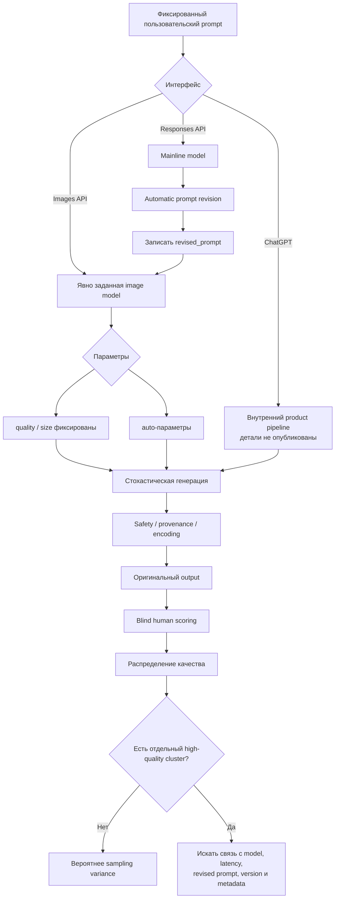

# Почему GPT иногда внезапно генерирует изображения заметно лучше: вариативность, скрытая маршрутизация и способы проверки

## Резюме

Наблюдение правдоподобно: один и тот же или почти тот же запрос действительно может иногда дать изображение, которое субъективно выглядит так, будто его сделал более сильный генератор. Похожие сообщения регулярно появляются у пользователей ChatGPT и API. Люди описывают как внезапные «удачные» генерации, так и обратный эффект: резкое падение качества при прежних промптах и настройках. Однако из доступных публичных данных **не следует, что OpenAI случайным образом тайно переключает конкретный запрос на «премиальную» модель**. На 13 октября 2026 года OpenAI действительно имеет два разных актуальных генератора GPT Image 2.5: `Flare`, ориентированный на скорость, и более сильный `Sunburst`, ориентированный на максимальное качество и точность. В API модель выбирается явно. OpenAI рекомендует Sunburst для сложных задач, где качество приоритетнее задержки. Это делает гипотезу о маршрутизации технически возможной для закрытого интерфейса ChatGPT, но **официального подтверждения автоматического переключения Flare → Sunburst в зависимости от сложности промпта, нагрузки, повторных попыток или специальных слов в запросе я не нашёл**. Форумные утверждения о подобных режимах существуют, но это наблюдения пользователей, а не документация OpenAI. Наиболее вероятное объяснение одиночной исключительно хорошей генерации проще: **стохастическая вариативность самой генерации плюс вариативность промежуточной интерпретации промпта**. Даже очень подробный запрос не задаёт единственного изображения. В апреле 2026 года сооснователь OpenAI Грег Брокман отдельно демонстрировал, что GPT Image 2 выдаёт существенно разные результаты на одном подробном промпте, и рекомендовал делать несколько попыток для важных задач. В Responses API добавляется ещё один источник вариативности: основной GPT-модельный слой **автоматически переписывает запрос для image-generation tool**. Причём этот `revised_prompt` API теперь позволяет получить. Кроме того, параметры `quality`, `size`, `background` и `action` могут иметь значение `auto`, то есть часть решений оставляется модели. Для текущего GPT Image API нет документированных параметров `seed` или `temperature`. Поэтому популярный совет «найдите удачный seed и повторяйте его» к современному GPT Image API неприменим. В текущем методе `images.generate` перечислены `model`, `quality`, `size`, `n`, формат, compression и другие параметры, но не seed/temperature. Практически наиболее надёжный способ получить «тот самый сильный режим» сейчас такой:

**API → явно выбрать `gpt-image-2.5-sunburst` → зафиксировать dated snapshot → поставить `quality="max"` → явно задать разрешение → PNG → создать несколько независимых кандидатов → выбрать лучший → дальнейшие изменения делать редактированием удачного изображения, а не новой генерацией с нуля.** Это опирается на документированные возможности, а не на попытку вызвать неизвестный скрытый переключатель. При этом исходные детали вашего конкретного случая **не указаны**: неизвестны точный интерфейс — ChatGPT или API, точное название модели, дата наблюдения, исходный промпт, использовались ли референсные изображения, был ли это новый чат или продолжение старого, какое было разрешение и сколько было повторов. Без них нельзя установить причину конкретного эпизода.

## Что официально известно о механизме генерации

### Сейчас действительно существуют генераторы разной силы

GPT Image 2.5 представлен двумя моделями. OpenAI называет Flare малой моделью, оптимизированной на скорость, а Sunburst — базовой моделью, оптимизированной на качество. В руководстве прямо рекомендуется начинать с Sunburst, когда GPT Image 2 не удовлетворяет требованиям сложного workflow, и только потом проверять, достаточно ли качества Flare. В официальном анонсе OpenAI описывает Flare как вариант для большинства приложений с более низкой задержкой, а Sunburst — как модель для premium visual workflows, требующих более точного контроля. API позволяет указать как плавающие имена:

`gpt-image-2.5-sunburst`  
`gpt-image-2.5-flare`

так и датированные snapshots:

`gpt-image-2.5-sunburst-2026-09-08`  
`gpt-image-2.5-flare-2026-09-08`. Это важный факт. Часть впечатления «будто иногда подключается другая модель» имеет реальную технологическую основу: **в продуктовой линейке действительно есть два современных генератора с разным quality/latency trade-off**. Но существование двух моделей само по себе ещё не доказывает скрытое случайное переключение между ними в ChatGPT.

OpenAI Images также неоднократно менялся в течение последнего года. В декабре 2025 года ChatGPT получил новое поколение Images, доступное в API как GPT Image 1.5. 21 апреля 2026 года был представлен Images 2.0. Нынешний Images 2.5 снова изменил качество, редактирование и скорость. Поэтому сравнение генераций, сделанных в разные месяцы, нельзя считать контролируемым экспериментом. Более того, OpenAI прямо предупреждает разработчиков, что поведение моделей может меняться между snapshots, а сами outputs являются вариативными. Для стабильности компания рекомендует фиксированные версии модели и собственные evals. ### Не только генератор определяет результат

Особенно важен Responses API. Его image-generation tool не просто передаёт пользовательскую строку в генератор. OpenAI пишет, что текст автоматически оптимизируется, а основной GPT-модуль автоматически делает revision запроса перед вызовом image model. В ответе можно получить поле `revised_prompt`. Получается, что видимый пользователю запрос

> «Сделай реалистичный портрет человека возле окна»

может фактически превращаться в существенно более подробную внутреннюю спецификацию композиции, освещения, материалов и прочего. Если этот промежуточный этап отличается от попытки к попытке, он потенциально способен давать результат, воспринимаемый как смена генератора. **OpenAI, однако, не утверждает в документации, что переписывание само по себе обязательно стохастично**, поэтому это объяснение следует считать вероятной гипотезой, а не установленной причиной.

Есть и другие автоматические решения. В Responses image tool `quality`, `size` и `background` поддерживают `auto`; `action=auto` позволяет системе самой решить, создавать новую картинку или редактировать существующую. Текущий default для quality — `auto`. В прямом Images API `quality="auto"` также означает автоматический выбор подходящего качества. Sunburst и Flare поддерживают уровни `low`, `medium`, `high`, `xhigh` и `max`. Поэтому для исследования феномена `auto` желательно отключать.

### Seed и temperature — важное отличие от привычных diffusion-систем

Для нынешнего `images.generate` OpenAI не документирует ни `seed`, ни `temperature`. Поэтому нельзя сделать стандартный эксперимент вида «одинаковый seed, разные backend conditions» или воспроизвести особенно удачный output только номером seed. На Stack Overflow ещё во времена DALL·E 3 пользователи пытались найти способ перенести seed-подобную воспроизводимость из интерфейса в API. Это показывает, что проблема давняя, но не является свидетельством наличия такого параметра в современном GPT Image API. Это также означает, что советы из Stable Diffusion, Flux и других систем вида:

`seed=123456`  
`CFG=7`  
`steps=40`  
`temperature=0.7`

нельзя автоматически переносить на GPT Image.

### «Перегенерация латентов» тоже не универсальное объяснение

В старой терминологии генераторов изображений принято говорить о diffusion process, latent noise и новом latent seed. Для DALL·E такая модель мышления была уместна. Но OpenAI официально описывал native image generation GPT-4o иначе: в отличие от diffusion-based DALL·E, GPT-4o image generation являлся **autoregressive** image generator, встроенным в мультимодальную модель. OpenAI не публикует достаточно деталей внутренней архитектуры нынешних GPT Image 2/2.5, чтобы достоверно утверждать, что Sunburst и Flare устроены точно так же. Поэтому выражение «случайно попался хороший latent» для текущего GPT Image скорее является удобной аналогией, чем установленным описанием механизма.

### Сравнение технических гипотез

| Гипотеза | Что должно происходить | Что известно | Оценка |
|---|---|---|---|
| **Обычная вариативность sampling** | Разные траектории генерации дают сильно различающиеся композицию, анатомию, свет и детализацию | GPT Image действительно даёт разнообразные outputs даже на одном подробном prompt; это публично демонстрировал Brockman | **Высокая вероятность** для одиночного «вау»-кадра. |
| **Разная внутренняя интерпретация / prompt rewrite** | Один и тот же пользовательский текст превращается в различающиеся эффективные инструкции | Responses API автоматически оптимизирует и переписывает prompt | **Высокая/средняя**; особенно для ChatGPT/Responses. |
| **`quality=auto`, `size=auto`, `action=auto`** | Система принимает скрытое для пользователя решение о режиме | Все эти автоматические режимы документированы | **Средняя/высокая**, если параметры не зафиксированы. |
| **Смена версии модели / rollout** | Поведение меняется после server-side rollout | OpenAI постоянно обновляет Images и предупреждает о различиях snapshots | **Высокая** для изменений между днями/неделями; хуже объясняет соседние секунды. |
| **Flare ↔ Sunburst routing внутри ChatGPT** | Некоторые запросы направляются на более сильный backend | Обе модели существуют; API позволяет явно выбрать их | **Технически правдоподобно, но не подтверждено для ChatGPT**. |
| **Model ensemble** | Несколько генераторов оценивают/генерируют кандидат и система выбирает лучший | Публичного описания такого ensemble для GPT Image 2.5 нет | **Нет достаточных свидетельств** |
| **Постобработка / hidden upscaler** | Иногда включается дополнительный restoration/upscale pass | Формат, compression, safety/provenance задокументированы; случайный «beautifier» — нет | **Низкая/неустановленная**. |
| **Кэш** | Cache hit каким-то образом даёт другой уровень генератора | Prompt caching предназначен для повторного использования вычислений prefix, уменьшения стоимости и latency | **Низкая**; свидетельств quality routing через cache нет. |
| **Rate limits / перегрузка** | При высокой нагрузке backend заменяет сильную модель дешёвой | Документация описывает RPM/TPM/IPM и ограничения, но не quality fallback | **Не подтверждено**. |
| **Разные GPU / kernel nondeterminism** | Небольшие численные различия меняют траекторию sampling | Нетерминизм GPU-вычислений является известным явлением, но image-specific evidence от OpenAI отсутствует | **Возможен как небольшой источник вариации**, слабое объяснение огромного скачка |
| **Модерация / safety path** | Prompt проходит через разные safety decisions | OpenAI использует chat-model checks, prompt classifiers и image checks | **Может менять допустимый результат**, но не выглядит общим объяснением случайного повышения эстетического качества. |

Главный вывод из таблицы: **не требуется гипотеза о скрытой более сильной модели, чтобы получить редкий выдающийся результат**. Достаточно распределения качества с широким «правым хвостом»: большинство генераций средние, несколько плохие, а иногда случайно совпадают удачная композиция, лицо, свет, детализация, фон и prompt adherence.

## Что об этом сообщают пользователи

Пользовательских сообщений много. Но они являются важным индикатором феномена, а не доказательством его механизма.

### Reddit и OpenAI Community

Очень близкое к исходному наблюдение опубликовано в r/ChatGPT: пользователь пишет, что иногда изображение получается очень реалистичным и детальным, а через несколько генераций качество резко переходит к типичному «AI slop». В другом обсуждении пользователь сообщает, что ещё накануне получал хорошие изображения, а затем за один-два часа результаты стали выглядеть как output старой модели: хуже фон и анатомия. Другие участники подтвердили похожее наблюдение, хотя это не контролируемый тест. После появления GPT Image 2 появились и сообщения, что первоначально модель выглядела заметно лучше, а позже стала хуже следовать сложным промптам. В комментариях буквально появляется предположение «looks like they swapped the model», но никакого backend metadata в обсуждении не приводится. OpenAI Developer Community даёт несколько особенно показательных случаев. 8 июня 2026 года пользователь, генерировавший сотни тестовых изображений для storyboard workflow, сообщил о резком ухудшении prompt adherence, лиц и анатомии в течение предыдущих суток. Другой участник сообщил, что ему пришлось перейти с `quality=low` на `medium`, чтобы восстановить приемлемый уровень. В июле другой пользователь утверждал, что тот же workflow использовался для тысяч изображений и изменился после outage. В той же ветке участник предположил наличие простого и более сложного режима генерации, основываясь на различающихся задержках и UI-поведении. Это интересная гипотеза, но её источник — пользователь форума, а не сотрудник OpenAI. Есть также сообщения о систематической разнице ChatGPT UI и Responses API. В одном случае одинаковый prompt и reference image давали в ChatGPT более реалистичный свет и текстуры, чем через API; другие участники сообщали аналогичное для своих задач. Это совместимо с гипотезой, что продуктовые pipeline отличаются prompt preprocessing, system context или настройками, но само обсуждение не устанавливает точную причину. ### Twitter/X

Наиболее значимое свидетельство здесь — не слух о routing, а демонстрация вариативности. Грег Брокман проверил GPT Image 2 несколькими генерациями одного подробного prompt и отметил большую разницу между результатами; практический совет в публикации — при важном изображении генерировать его несколько раз. Это хорошо согласуется с гипотезой **tail sampling**: лучший из четырёх outputs может казаться созданным принципиально лучшей моделью, хотя backend был тем же.

### Stack Overflow

Stack Overflow содержит меньше наблюдений именно о «внезапно включившейся сверхмодели». Там преобладают вопросы о воспроизводимости и различиях интерфейсов.

В 2024 году пользователь DALL·E 3, например, пытался воспроизводить персонажей через seed, который, по его впечатлению, помогал в веб-интерфейсе, но не понимал, как получить тот же контроль в Python API. Это старый стек и не следует переносить этот опыт на GPT Image 2.5. Есть также сообщение об Azure OpenAI, где DALL·E 3 Playground выдавал хороший результат, а тот же текст через Python — заметно хуже. Это косвенно показывает, что «одинаковый видимый prompt» не гарантирует эквивалентность всего execution pipeline, однако речь идёт о старом Azure/DALL·E окружении. ### Русскоязычные Telegram-источники

Русскоязычные Telegram-каналы активно фиксировали rollout новых image-моделей. Например, Data Secrets сообщал о начале развёртывания GPT Image 2 и необычно сильных первых генерациях; другие русскоязычные каналы сейчас отдельно обсуждают Flare и Sunburst как варианты с различным соотношением скорости и качества. Но при поиске русскоязычных источников **не удалось обнаружить убедительный воспроизводимый эксперимент**, показывающий, что определённая русская фраза, последовательность retry или режим общения стабильно принуждает ChatGPT переключиться на Sunburst/«старшую» модель.

Показателен другой распространённый тип контента: Telegram-подборки советуют писать `/4k`, `/8k`, `/ultrarealistic` и подобные модификаторы. При этом даже автор такой подборки отдельно уточняет, что это **не настоящие команды ChatGPT**, а просто короткие текстовые описания желаемого визуального результата. Поэтому `/8k`, `ultra quality`, `masterpiece`, «используй самый сильный генератор» и подобные конструкции не следует путать с реальным backend switch.

### Сводка сообщений

| Источник | Наблюдение | Что оно поддерживает | Что оно не доказывает |
|---|---|---|---|
| Reddit | «Иногда реалистично и детально, потом резко хуже» | Большая intra-session variance | Смену модели. |
| Reddit | Резкое ухудшение в течение часа | Возможный rollout/backend incident | Причину и конкретную модель. |
| Reddit, GPT Image 2 | После сильного старта некоторые видят regression | Возможное изменение backend или параметров | Что OpenAI тайно заменил модель. |
| OpenAI Community | Сотни стабильных outputs, затем ухудшение | Версионный или operational shift заслуживает проверки | Это пользовательское наблюдение, не официальный incident report. |
| OpenAI Community | ChatGPT UI лучше API на том же видимом prompt | Pipeline/context/preprocessing имеют значение | Конкретный механизм. |
| X, Greg Brockman | Один detailed prompt → заметно разные outputs | Сильную обычную вариативность | Routing между моделями. |
| Stack Overflow | Пользователи ищут seed и сталкиваются с UI/API differences | Проблему воспроизводимости | Современный GPT Image seed. |
| Russian Telegram | Отмечаются rollout новых GPT Image и Flare/Sunburst | Реальные модельные изменения воспринимаются сообществом | Существование «секретной команды» переключения. |

Таким образом, **сам феномен подтверждается большим количеством независимых анекдотических наблюдений**. А вот механизм «иногда нас тайно переводят на более сильную модель» остаётся неподтверждённым.

## Как это проверить экспериментально

Правильный эксперимент должен разделить четыре возможных явления:

1. обычный sampling variance;
2. эффект `auto`-параметров;
3. различия моделей Flare/Sunburst;
4. server-side изменение версии или ChatGPT pipeline.

Ниже — набор тестов, который позволяет сделать это сравнительно строго.

### Базовый тест случайности на фиксированном snapshot

Цель — узнать, может ли **одна неизменная модель сама по себе** производить редкие «аномально хорошие» outputs.

Использовать:

```text
endpoint: Images API
model: gpt-image-2.5-sunburst-2026-09-08
quality: max
size: 1536x1024
background: opaque
output_format: png
n: 1
seed: недоступен
temperature: недоступна
```

Эти параметры поддерживаются текущим API; `seed` и `temperature` в image-generation schema не представлены. Пример фиксированного stress-test prompt:

```text
Фотореалистичная редакционная фотография мастера-часовщика
за деревянным верстаком в Праге вечером.

Камера на уровне глаз, объектив 35 мм.
Естественный мягкий свет из окна слева.
Тёплые лампы на заднем плане.

В правой руке человек держит ровно одну часовую лупу.
В левой руке — одну латунную шестерёнку.
Обе кисти полностью видны, по пять пальцев.

На стене одна чистая вывеска с точным текстом:
«МАСТЕРСКАЯ 1926»

Реалистичная текстура кожи и дерева.
Естественные несовершенства.
Без пластиковой кожи.
Без дополнительных пальцев.
Без дублированных объектов.
Без лишнего текста.
Без иллюстративного или CGI-стиля.
```

Сделать **100 отдельных запросов**, а не одну генерацию и 100 edits. Сохранять исходный PNG каждого результата.

Почему 100: здесь интересует не только среднее качество, но и редкий верхний хвост распределения. При 10 запусках «одна на двадцать» аномалия легко останется незамеченной.

Затем полностью повторить тест с:

```text
model: gpt-image-2.5-flare-2026-09-08
```

Все остальные поля оставить неизменными. Именно такой принцип — менять модель, сохраняя prompt, references, dimensions и format — рекомендует OpenAI для сравнительного тестирования Flare и Sunburst. Если внутри фиксированного Sunburst snapshot уже обнаружатся outputs уровня «другая модель», гипотеза о необходимости backend switch существенно ослабляется.

### Проверка `auto` против фиксированного compute/quality

Для одного snapshot:

| Условие | Повторов |
|---|---:|
| `quality=auto` | 50 |
| `quality=high` | 50 |
| `quality=xhigh` | 50 |
| `quality=max` | 50 |

Размер, prompt и формат фиксируются.

Если `auto` имеет намного более широкое распределение и особенно выраженные верхний и нижний хвосты, автоматический выбор параметров становится кандидатом на объяснение. Если `max` просто сдвигает всю выборку вверх, это означает, что гораздо надёжнее покупать качество напрямую, чем искать загадочный trigger.

OpenAI подтверждает существование всех этих quality levels и автоматического режима. ### Проверка alias против snapshot

Это ключевой тест server-side drift.

Сравнивать одновременно:

```text
gpt-image-2.5-sunburst
```

и

```text
gpt-image-2.5-sunburst-2026-09-08
```

Например, семь дней:

| Каждый день | Alias | Snapshot |
|---|---:|---:|
| Один и тот же prompt | 20 | 20 |

Запросы необходимо чередовать случайным образом:

```text
snapshot
alias
alias
snapshot
snapshot
...
```

а не сначала сделать все alias, затем все snapshot.

OpenAI прямо рекомендует pinned model versions, если нужна стабильность между snapshots. Сильный сдвиг только у alias при стабильном snapshot был бы гораздо более убедительным свидетельством изменения версии, чем впечатления от нескольких картинок.

### ChatGPT против прямого API

Это наиболее интересный эксперимент именно для гипотезы скрытого переключения.

Для одного prompt сделать четыре условия:

| Условие | Повторов |
|---|---:|
| ChatGPT, каждый раз новый чат | 30 |
| ChatGPT, все повторы в одном диалоге | 30 |
| API Flare snapshot | 30 |
| API Sunburst snapshot | 30 |

В ChatGPT не нужно писать судьям, какое условие использовалось.

Если «аномально прекрасные» ChatGPT-outputs образуют кластер, статистически похожий на Sunburst и заметно отличающийся от Flare, это будет интересным косвенным свидетельством. Но **визуальное сходство всё равно не сможет доказать routing**. Для доказательства нужен backend identifier, provenance metadata или официальное подтверждение.

### Проверка автоматического prompt rewrite

Responses API делает этот эксперимент особенно полезным, поскольку `revised_prompt` возвращается в image-generation call. Сделать 50 независимых Responses requests с абсолютно одинаковым visible prompt:

```text
top-level model: фиксированный
image_generation model: gpt-image-2.5-sunburst-2026-09-08
quality: max
size: 1536x1024
```

Для каждого запроса сохранить:

```text
visible_prompt
revised_prompt
generated_image
latency
response id
created time
```

Затем посмотреть, идентичны ли `revised_prompt`.

Если особенно хорошие изображения коррелируют с определёнными дополнительными инструкциями в rewritten prompt — например, модель чаще добавляет конкретный свет, объектив, skin texture или композиционные ограничения — часть «магического переключения» будет объяснена **не сменой генератора, а удачным prompt expansion**.

Это один из самых сильных доступных сегодня экспериментов.

### Проверка нагрузки и rate limits

Официально rate limits ограничивают RPM, TPM, RPD и IPM и используются в том числе для управления нагрузкой. Документация не говорит, что OpenAI при высокой нагрузке переводит изображение на более слабый генератор. Тем не менее гипотезу можно проверить эмпирически.

На протяжении семи дней по времени Праги:

| Время | Генераций |
|---|---:|
| 02:00 | 8 |
| 08:00 | 8 |
| 14:00 | 8 |
| 20:00 | 8 |

Это 224 изображения на условие за неделю.

Использовать только pinned snapshot. Фиксировать latency, ошибки и rate-limit информацию.

Затем оценить модель:

```text
quality_score ~ time_of_day + latency + day + error/retry history
```

Если high-quality outliers не коррелируют ни со временем, ни latency, гипотеза «в тихие часы запускают сильную модель» заметно ослабнет.

### Матрица рекомендуемых экспериментов

| Тест | Главный вопрос | Минимум | Предпочтительно | Что считалось бы интересным результатом |
|---|---|---:|---:|---|
| Snapshot repeated sampling | Может ли одна модель сама давать «магические» результаты? | 50 | 100 | Широкий верхний хвост |
| Flare vs Sunburst | Похож ли «магический» output на сильную модель? | 30+30 | 100+100 | Явный разрыв distributions |
| Auto vs Max | Виноваты ли auto settings? | 30 на режим | 50 | У `auto` больше variance |
| Alias vs pinned snapshot | Идёт ли server-side drift? | 10/день | 20/день | Alias меняется, snapshot нет |
| Responses prompt rewrite | Влияет ли скрытая формулировка? | 30 | 50–100 | Quality связана с revised prompt |
| ChatGPT new-chat vs same-chat | Влияет ли контекст? | 30+30 | 50+50 | Сильная разница variance/mean |
| Time/load | Есть ли эффект нагрузки? | 100 | 200+ | Quality коррелирует с time/latency |

## Какие метаданные собирать и как анализировать результаты

Без metadata практически невозможно различить «другую модель» и случайно удачную генерацию.

### Минимальный журнал каждого запуска

Стоит сохранять одну строку данных на каждый output:

| Поле | Зачем |
|---|---|
| `timestamp_utc`, `timestamp_local` | Поиск rollout/time-of-day effects |
| Endpoint | Images API / Responses / ChatGPT UI |
| Exact model string | Flare/Sunburst, alias или snapshot |
| Mainline Responses model | Может влиять на prompt revision |
| Exact visible prompt | Контроль идентичности |
| SHA-256 prompt | Быстрая проверка случайных изменений |
| `revised_prompt` | Критически важно для Responses |
| Полная conversation history | Проверка context effect |
| Reference image hashes | Проверка идентичности input |
| Порядок reference images | Порядок тоже должен быть фиксирован |
| `quality` | Не смешивать auto/high/max |
| `size` | Sharpness может зависеть от размера |
| `background` | Фиксация параметра |
| `output_format` | PNG/JPEG/WebP |
| `output_compression` | Исключение encoding artifact |
| `action` | generate/edit/auto |
| `n` | Число кандидатов |
| Seed | `unavailable` для текущего GPT Image |
| Temperature | `unavailable` |
| Latency | Проверка предполагаемого «дорогого режима» |
| Retry count | Не смешивать retry behavior |
| Response/operation identifier | Связывание с логами |
| Width × height фактического файла | Выявление изменения resolution |
| Размер файла | Грубый индикатор encoding complexity |
| SHA-256 output | Выявление exact duplicates |
| Human scores | Основная метрика качества |

API официально позволяет контролировать model, n, compression, output format, quality и size; `n` может составлять от 1 до 10. Для JPEG/WebP следует отдельно учитывать `output_compression`; для экспериментальной оценки визуального качества проще использовать PNG, чтобы не смешивать ошибки генерации с compression artifacts. OpenAI также использует C2PA metadata и SynthID для provenance текущих изображений. C2PA может исчезать после редактирования, конвертации или пересылки, поэтому сохранять желательно оригинальный downloaded file. ### Человеческая оценка важнее одной автоматической метрики

До просмотра результатов следует заранее определить критерии. Например, каждый output получает от 1 до 5:

| Критерий | Что оценивать |
|---|---|
| Prompt adherence | Все ли заданные объекты и отношения присутствуют |
| Anatomy | Руки, пальцы, лица, позы |
| Photorealism | Нет ли пластикового/CGI-вида |
| Fine detail | Текстуры, волосы, ткани, мелкие элементы |
| Lighting | Физическая правдоподобность |
| Typography | Точный текст и читаемость |
| Composition | Баланс, перспективу, кадрирование |
| Overall preference | Общая профессиональная пригодность |

Желательно скрыть имя модели, порядок рандомизировать и использовать минимум несколько независимых оценщиков.

Для парных сравнений Flare/Sunburst удобнее не спрашивать «поставьте 1–10», а показывать два изображения вслепую:

```text
A лучше
B лучше
ничья
```

После сотен сравнений можно оценить Bradley–Terry preference score.

### Особое внимание — не среднему, а хвосту

Пользовательское наблюдение относится не к среднему quality, а к редкому событию:

> «Иногда появляется картинка совсем другого уровня».

Поэтому одной средней оценки недостаточно.

Полезно заранее определить:

```text
exceptional = composite_score >= заранее заданного порога
```

или, для предварительного исследования:

```text
exceptional = верхние 10% по blind human score
```

И считать:

\[
P(\text{exceptional}\mid\text{condition})
\]

с доверительным интервалом.

Это непосредственно отвечает на практический вопрос: например, не «Sunburst в среднем на 0,4 балла лучше», а:

```text
Flare:     7% exceptional
Sunburst: 24% exceptional
ChatGPT:  15% exceptional
```

Такая картина уже позволяет говорить предметно.

### Как искать признаки двух скрытых режимов

Если система действительно переключается между условными A и B, распределение может выглядеть не как один плавный bell-shaped cloud, а как два режима.

Стоит сравнить:

- однокомпонентную модель распределения quality scores;
- двухкомпонентную mixture model;
- распределения latency;
- output dimensions;
- revised prompts;
- provenance/model metadata.

Но **бимодальность сама по себе не доказывает две модели**. Одна генеративная модель может иметь несколько естественных визуальных modes.

Гораздо сильнее было бы наблюдение вида:

```text
кластер высокого качества:
latency ≈ 55 s
resolution = X
metadata characteristic = A

обычный кластер:
latency ≈ 12 s
resolution = Y
metadata characteristic = B
```

и повторение этого эффекта на нескольких независимых prompts.

### Предлагаемые визуализации

Наиболее информативны:

**Violin plot / boxplot**

```text
             Quality score
Flare       ▂▃▇████▅▂
Sunburst       ▂▄██████▆▃
ChatGPT       ▂▃▅████▇▅▂
```

Показывает не только среднее, но и variance и хвосты.

**ECDF** — особенно полезна для вопроса «какой процент outputs выше quality threshold».

**Scatter plot**

```text
x = latency
y = blind quality score
marker = model/condition
```

Если предполагаемый «второй сильный режим» действительно требует существенно больше compute, может появиться кластер справа-сверху. Отсутствие такого кластера ослабит гипотезу.

**Time-series**

```text
x = дата/время
y = quality score
```

С вертикальными линиями на официальных releases/outages. Для 2026 года это особенно существенно, поскольку OpenAI несколько раз менял image stack. **Upper-tail chart**

```text
% outputs with score ≥ threshold
```

Это лучшая практическая диаграмма для оценки «шанса поймать очень хороший вариант».

Концептуальный workflow исследования:



Пункт `ChatGPT → internal product pipeline` намеренно оставлен неопределённым: публичных данных недостаточно, чтобы подставить туда Flare, Sunburst или конкретную routing policy.

## Как практически повысить вероятность очень хорошей генерации

### Не пытаться вызвать switch, если модель можно выбрать напрямую

Для API это главный ответ.

Вместо:

```text
«Пожалуйста, используй самую сильную модель»
```

лучше непосредственно задать:

```python
model="gpt-image-2.5-sunburst-2026-09-08"
quality="max"
size="2048x1152"
output_format="png"
```

Sunburst официально предназначен для более требовательных по качеству workflows, а `max` является документированным quality level. Плавающий alias полезен для доступа к обновлениям. Для воспроизводимости лучше dated snapshot. OpenAI прямо рекомендует pinned versions и evals для стабильного поведения. ### Генерировать несколько независимых кандидатов

Это, вероятно, самый недооценённый способ получить ощущение «старшей модели».

Если вероятность exceptional result в одном запуске равна \(p\), то вероятность хотя бы одного такого результата среди \(k\) примерно равна:

\[
1-(1-p)^k
\]

Например, при условном \(p=10\%\):

| Независимых попыток | Шанс получить ≥1 exceptional |
|---:|---:|
| 1 | 10.0% |
| 4 | 34.4% |
| 8 | 57.0% |
| 10 | 65.1% |

Реальные outputs не обязательно полностью независимы, поэтому это иллюстрация, а не гарантия.

Но принцип подтверждается практическим наблюдением Брокмана: GPT Image 2 заметно варьирует output при одинаковом подробном prompt. API поддерживает `n` до 10, хотя для научного эксперимента предпочтительнее отдельные запросы с `n=1`, чтобы проще отслеживать latency и metadata каждой попытки. ### Отключать `auto`, когда требуется контроль

Для production-процесса, где нужен максимум качества:

```text
quality=max
size=<явное значение>
background=<явное значение>
action=generate или edit
```

обычно является лучшей контрольной стратегией, чем оставление нескольких параметров в `auto`.

Это не означает, что `auto` плох. Он удобен. Но он вводит ещё одну переменную в эксперимент. `quality`, `size` и `background` действительно имеют автоматические режимы, а Responses API может автоматически выбирать generate/edit. ### Сделать prompt менее магическим и более операционным

Официальное руководство OpenAI строит prompts вокруг конкретных визуальных свойств и отдельно подчёркивает необходимость сохранять prompt, reference inputs, dimensions и format неизменными при сравнении моделей. Полезнее:

```text
eye-level camera
35 mm lens
soft window light from camera-left
natural skin texture
visible pores
realistic contact shadows
five fingers on each visible hand
text EXACTLY: "..."
no extra text
```

чем:

```text
masterpiece
8K
insane quality
award winning
ultra ultra realistic
activate best model
```

Последние слова могут влиять на эстетическую интерпретацию как обычный prompt, но не являются задокументированными переключателями backend. Даже русскоязычные подборки `/4k` и `/8k` прямо указывают, что это не настоящие slash-команды. ### Не уничтожать удачный результат новой генерацией с нуля

Когда получена действительно сильная картинка, лучше превратить её в новый reference и делать небольшие edits.

OpenAI специально подчёркивает способность современных GPT Image сохранять subject и детали при editing, а prompting guide рекомендует локально формулировать изменения — например, поменять один объект, сохранив композицию, свет и окружение. Практический workflow:

```text
20 кандидатов
      ↓
выбрать лучший
      ↓
сохранить оригинальный PNG + prompt + metadata
      ↓
использовать этот output как reference
      ↓
одна правка за шаг
      ↓
не менять одновременно свет + позу + одежду + фон + камеру
```

Это гораздо надёжнее попытки снова случайно попасть в тот же удачный region распределения.

### Для Responses анализировать `revised_prompt`

Это один из немногих доступных способов посмотреть, что происходило между вашей фразой и image generator.

Responses API официально возвращает автоматически переработанный `revised_prompt`. Поэтому при особенно хорошем output следует сохранять не только пользовательский prompt, но и rewritten version. Возможно, именно там окажется повторяемый рецепт хорошего результата.

### Не рассчитывать на кэш, rate-limit cycling или время суток

Prompt caching официально предназначен для повторного использования prefix computation, сокращения latency и стоимости. Документация не описывает cache hit как механизм выбора более сильного image model. А rate limits определяются через ограничения RPM/TPM/IPM и служат управлению доступом и нагрузкой. В официальной документации нет режима «при свободных GPU дать Sunburst, при нагрузке дать слабую модель». Поэтому советы:

```text
подождать до ночи
сделать 5 быстрых retry
упереться в лимит и повторить
очистить cache
использовать VPN
```

сейчас не имеют достаточного подтверждения как способ получить более сильный генератор.

### С аппаратной вариативностью ситуация похожая

Низкоуровневые GPU-вычисления в ML могут быть недетерминированными, а порядок floating-point операций способен давать небольшие различия. Это известное свойство современных ускоренных ML-систем. Но публичных данных, показывающих, что GPT Image иногда выглядит «на целое поколение лучше» именно из-за другого GPU или kernel, нет.

Для стохастического autoregressive процесса небольшое численное отличие теоретически может быть усилено последующими sampling decisions. Но практически такую причину следует ставить значительно ниже обычного sampling variance, prompt rewrite или model/version differences.

### Что считать рабочей стратегией, а что — неподтверждённым фольклором

| Приём | Статус |
|---|---|
| Явно выбрать Sunburst | **Подтверждено и рекомендуется OpenAI**. |
| `quality=max` / `xhigh` | **Официальный API-параметр**. |
| Зафиксировать dated snapshot | **Лучший способ уменьшить version drift**. |
| Явно задать размер | **Официально поддерживается**. |
| PNG вместо lossy output для тестов | **Убирает compression как confounder**; API поддерживает PNG/JPEG/WebP. |
| Сделать несколько независимых генераций | **Рационально при высокой stochastic variance**; такую вариативность демонстрировал Brockman. |
| Использовать удачный output как reference | **Поддерживается image-editing workflow OpenAI**. |
| Анализировать `revised_prompt` | **Доступно в Responses API**. |
| «Сделай на самой мощной скрытой модели» | **Нет документированной гарантии** |
| «Think harder, чтобы включился Sunburst» | **Форумная гипотеза, официально не подтверждена**. |
| `/8k`, `/ultrarealistic` как системная команда | **Не является реальной slash-командой**. |
| Найти хороший GPT Image seed | **Современный image API seed не предоставляет**. |
| Менять temperature | **Такого image parameter в текущем API нет**. |
| Генерировать только ночью | **Нет подтверждения** |
| Провоцировать rate limit | **Нет подтверждения; скорее ухудшает эксплуатационную надёжность**. |
| Cache hit = более качественная модель | **Документация этого не поддерживает**. |

Итоговый диагноз на основании доступных данных: **случайный необычно высокий quality output реален, но наиболее экономное объяснение — широкий stochastic quality distribution, усиленный prompt rewriting, контекстом и автоматическими параметрами. Изменение model version способно объяснить скачки между периодами. Скрытая маршрутизация между Flare и Sunburst в ChatGPT остаётся технически возможной, однако публичных доказательств её существования или пользовательского способа намеренно вызвать такой switch сейчас нет.**

Поэтому для практической работы лучше не искать «секретную фразу». В API эквивалент желаемого переключения уже доступен напрямую: **Sunburst + pinned snapshot + `quality=max` + фиксированный размер + несколько кандидатов + сохранение лучшего результата как reference**. Для ChatGPT наиболее полезная стратегия — несколько независимых генераций, строгий prompt, сохранение удачного изображения и дальнейшее итеративное редактирование, одновременно логируя время, контекст и исходные файлы.